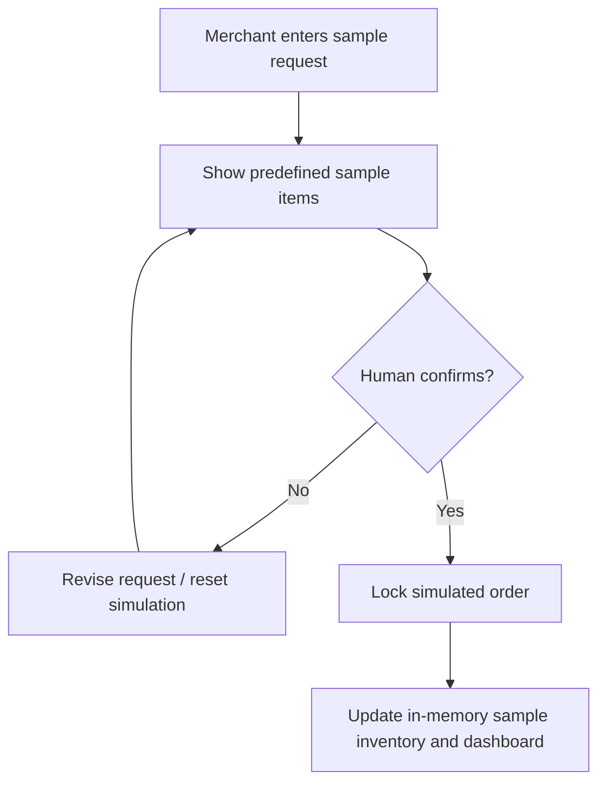

# WEEK 14 — BUSINESS BENDING PACKET | FERREBOT
**Status:** prepared before Week 14 code corrections; this is a scoped, testable plan, not evidence of completed user validation.

## 1. Problem, payer and outcome
Mexican hardware retailers often place informal orders; ambiguity in product, unit and quantity may cause follow-up and errors. The retailer is the ordering user; a distributor is the **hypothesized** paying buyer. No payer willingness-to-pay has been established. Success for this week's demonstration: an accessible pricing page, 3 transparent tiers, a working and locally saved revenue scenario, explicit human confirmation in the demo, and an evidence-labeled value comparison.

## 2. Pricing bet and free/paid boundary
- Demo MXN 0: seeded order simulation and sample dashboard, not a live service.
- Starter MXN 799/month (proposed): future distributor order workflow, review and history; not yet for sale.
- Growth MXN 1,499/month (proposed): future multi-operator/reporting capabilities; not yet for sale.
- Retailers are not charged to place basic orders under the proposed model.
- Revenue is an illustrative forecast, not profit or actual subscriptions.

## 3. Mockup / page map
```text
/           → FerreBot Control Room (simulated order, human confirmation, sample dashboard)
/pricing    → 3 pricing tiers → editable revenue assumptions → save / load scenario locally
/about      → manual process vs general software vs FerreBot; transparent 10:1 threshold
```

## 4. Workflow

The demo does **not** actually parse arbitrary order text, call WhatsApp, persist transactions, or validate stock with a real supplier.

## 5. International benchmarks and adaptation
- Choco (https://choco.com/) demonstrates supplier-facing B2B food ordering workflows. Lesson: consider charging the supplier/distributor rather than small ordering merchants; the sectors are not interchangeable.
- Sana Commerce (https://www.sana-commerce.com/) demonstrates ERP-integrated B2B ordering. Lesson: inventory and price integrity matter; a small distributor may not have ERP capacity.
These are design benchmarks, not evidence of Mexican demand or equivalent prices.

## 6. Vision, scope and architecture
Vision: reliable, low-friction B2B orders with a mandatory human verification gate. Week 14 scope: Next.js App Router + Tailwind UI, React client state, browser localStorage for pricing scenarios, Vercel production deployment. Out of scope: production WhatsApp API, live AI parser, payment processing, Supabase/ERP integration, verified savings, real-time inventory.

## 7. Revenue formula and assumptions
Paying customers (expected value) = reached distributors × conversion percentage / 100.
Monthly gross revenue = expected payers × monthly MXN price.
Annualized gross revenue = monthly gross × 12.
Base illustration: 100 reached × 10% × MXN 799 = MXN 7,990 monthly / MXN 95,880 annualized. No costs, churn or taxes included. A literal 10:1 threshold at MXN 799 requires MXN 7,990 of monthly customer value; this has not been observed.

## 8. Test plan and evidence requirements
1. Public /pricing and /about render without Vercel login.
2. Input 200 prospects, 10% conversion, 799 price → MXN 15,980 monthly / 191,760 annualized.
3. Save a named scenario, refresh browser, load it and verify values.
4. Input 0 prospects → 0 revenue; conversion cannot exceed 100%.
5. Confirm an order only through the explicit gate; verify reset returns sample state.
6. Test mobile layout and keyboard access.
7. Ask a **real distributor budget holder** about order volume, current error/time costs and willingness to pay at MXN 799; preserve actual response and permission.
8. Capture actual bug → fix, dated screenshots, commit history and 2 actual production deployments; do not invent evidence.

## 9. Shadow clause and risk controls
No automatic dispatch; human confirms sample order. Explicit labels for seeded data and hypothetical revenue. Avoid claims of end-to-end encryption, live integrations, verified fill rate or sales lost when the demo does not prove them. The Week 14 team Blueprint remains a working draft with missing Technologist input; this packet adopts its proposed FerreBot payer direction, not a fictional team vote.

## 10. Open questions
Actual payer and purchase conditions; onboarding/support cost; unit economics and retention; field testing; production data protection. The previous Week 12 venture AquaRail was pivoted to FerreBot in Week 13 and that history remains acknowledged in CHARTER.md.
