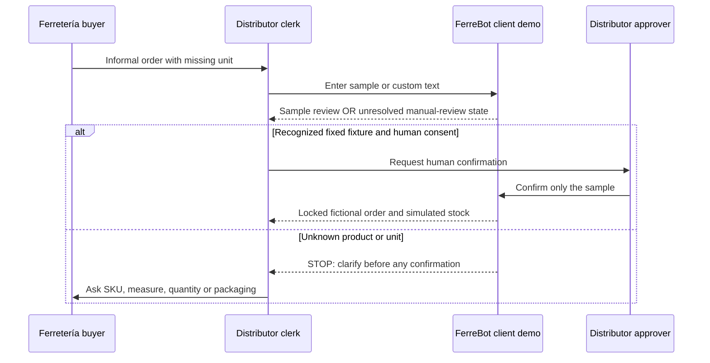
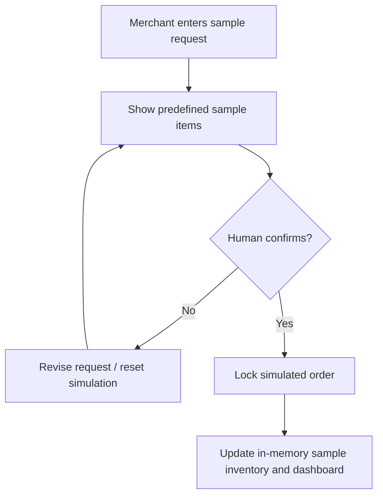

# WEEK 15 - DISTRIBUTION | FERREBOT LAUNCH PLAYBOOK

**Author:** José Luis Segon Bustamante | **Role:** Adversary | **Status:** Pre-implementation plan and source-backed hypotheses, 22 November 2026.

## 1. Decision, audience and moment

**Decision:** Test a narrow message, "Review a hardware order before confirming it," before selling general AI order automation. The **first audience** is a Mexican small-distributor owner or operations manager who processes informal requests and could approve a workflow pilot. The **daily users** are distributor order clerks and hardware-store staff; the **hypothesized payer** is the distributor. These roles must not be conflated. The moment of need is an incomplete SKU, size, package or unit in an incoming order, before a human commits it. The familiar alternative is another message, a phone call, a catalogue lookup or existing order-entry software. This workaround could be sufficient; no interview has measured its burden.

**First action offered:** a public, fictional order-review demonstration and an optional invitation to discuss a pilot. **Not targeted now:** household DIY consumers, national ERP-heavy accounts, or buyers demanding live WhatsApp/ERP integration. No actual outreach or willingness-to-pay response is claimed here.

## 2. Falsifiable proposition and evidence discipline

- **Defensible current promise:** "See a simulated hardware order before you confirm it." The linked Next.js prototype visibly presents sample line items and a human confirmation gate.
- **Hypothesis to test:** A distributor decision-maker finds the unresolved-unit check useful enough to request a demonstration or identify a specific current cost. This has not been established.
- **Promise we will not make:** "FerreBot automatically reads WhatsApp orders, prevents every error and saves MXN 7,990 monthly." No live WhatsApp ingestion, arbitrary-message LLM extraction, verified savings, payer commitment, or end-to-end ERP integration is present in the inspected production code.
- **Measured versus simulated:** All SKU matches, percentages, logs, inventory and examples in the public demo are synthetic. Pricing is a concept; MXN 799/month is not a validated market price.

## 3. Global benchmarks and Mexican translation

1. **Yalo / Coca-Cola FEMSA** (company case study): credible deployed Latin American WhatsApp B2B distribution channel, but grocery purchasing and vendor-reported conversion figures do not validate FerreBot's hardware SKU workflow. [Yalo source](https://www.yalo.ai/casos-de-exito/coca-cola-femsa-digitaliza-mas-de-1-millon-de-tienditas-en-america-latina).
2. **Orderlion**: software offered to wholesalers for converting informal requests into structured order workflows; its product category means messaging conversion is not novel. Hardware unit and catalogue behavior still need local testing. [Orderlion source](https://www.orderlion.com/en/contact-us).
3. **Handl**: a direct Mexican distributor competitor advertising WhatsApp/PDF order intake, SKU validation and human approval, including ferretería. Treat its claims as vendor claims, not audited outcomes. It challenges any claim that a confirmation gate is unique. [Handl source](https://www.handl.mx/).

**Mexico-specific design choice:** Show a Spanish sample such as "2 bultos de cemento y clavos" and flag **clavos: medida y unidad pendientes**. Truper's distributor catalogue states that box/master-pack quantities may change and be adjusted during order capture; this supports a concrete packaging-reconciliation test, not a claim about nationwide error rates. [Truper 2026 catalogue](https://www.truper.com/CatVigenteDist/termopares-termocoples-y-valvulas-foset-495.html).

## 4. Brand voice and visual rules

**Audience language:** Customer-facing pieces use plain Mexican Spanish. Coursework explanation and the evidence ledger use English; the translation is intentional.

1. **Show the decision, not the buzzword:** state what a person can inspect; avoid "revolutionary AI," "zero errors," and "instant automation."
2. **Disclose the limit in the same frame:** sample data, manual confirmation and no live WhatsApp connection must be visible with the benefit.
3. **Respect working vocabulary:** use *pedido, medida, unidad, SKU, caja, pieza, bulto* and one action verb per CTA; do not imply users need technical AI knowledge.

**Weak line and rewrite:** "Order intake, without the back-and-forth" implies an unmeasured reduction. Replace with **"Revisa el pedido antes de confirmarlo"** (English evidence line: "See the order before you confirm it"). Supporting line: "Simulación con productos de ejemplo y revisión humana." The outcome is a reproducible action, not promised savings.

**Visual system:** warm background `#F8F4EC`, dark blue-green `#0A4F50`, charcoal `#243333`, amber `#E8A332` only for unresolved fields, soft border `#DCE6E3`. Hierarchy: 32-44px semibold headline, 18-22px section title, 14-16px readable body, 12px monospace only for SKU/demo labels. Reusable two-panel layout: left = raw order request, right = proposed checklist with ambiguity badge; bottom = explicit human-review CTA and a disclosure. Do not use stock photos as proof of a working service.

**Generated concept mockup:** `W15_FerreBot_Concept_Mockup.png` was generated **before product changes** as a design reference. It is not a screenshot of the deployed system; include it in the packet PDF and compare to actual screens during testing.

## 5. Six concept plan: three recurring series

| Series | Concept A - finished asset | Concept B - planned concept only | Intended question |
|---|---|---|---|
| **Antes de confirmar** | **A1: "Clavos sin medida"** - 1080×1350 share image showing a vague order and highlighted missing nail size/unit, labeled demo. | A2: "Caja o pieza" - two-panel sketch about package quantities, no numeric performance claim. | Does the reader spot an ambiguity before confirmation? |
| **Del mensaje al control** | **B1: "Un pedido, tres decisiones"** - interactive HTML walkthrough in `/launch` with raw text, proposed sample item, manual clarification and stop decision. | B2: "¿Qué hace realmente la demo?" - honest capability/limitation headline. | Can the viewer name the next human action? |
| **El costo de la ambigüedad** | **C1: "El costo debe medirse"** - printable/downloadable one-page PDF checklist with empty fields for actual correction time and order count. | C2: "¿Vale MXN 799?" - calculation sketch with explicitly hypothetical assumptions. | Will a payer offer actual time/cost data or a pilot conversation? |

**Formats:** branded static image (A1), interactive web content (B1) and a printable PDF (C1). These are three intentionally different finished content formats, not six invented published posts. A2/B2/C2 are documented concepts only.

## 6. Auditable creative process and approval

| Role | Input | Output | Quality gate |
|---|---|---|---|
| Research | GitHub deployment, role brief, official vendor sources, Mexican catalogue | Claim ledger: supported, vendor-reported, hypothesis, unknown | Source link, date, category relevance, no invented local statistics |
| Writing | Audience moment, claim ledger, one CTA | Plain-Spanish headline, caption and small-print disclosure | Promise can be demonstrated on today's URL |
| Visual production | Voice rules, sample order fixture, mockup | Branded graphic, interactive page, PDF template | Accessible contrast, mobile legibility, disclosure stays visible |
| Evidence / claim check | Draft assets and live build | Pass/revise list with exact unsupported phrases removed | No fabricated accuracy, ROI, client data, contact or engagement |
| Style review | Revised assets and 3-rule voice guide | Consistent vocabulary, color and CTA review | Reader can identify audience, problem, next step in five seconds |
| Revision / human owner | Review notes and actual usability observations | Versioned release decision and notes | **José Luis explicitly approves every public-facing claim before external distribution** |

AI may assist in each role; there is no claimed automatic multi-agent system. Drafting/review steps are inspectable in the repo and actual conversation. Publication of content and outreach require human approval.

## 7. One traceable input to useful output

**Raw fictional input:** "Oye, mándame dos bultos de cemento y clavos urgente." **Research:** the request omits nail length/package, and supplier catalogue packaging can vary. **Writing:** "¿Qué medida de clavo y en qué presentación?" **Visual:** display the original line beside an amber **PENDIENTE** field. **Claims check:** label the sample as simulated and do not present 98% as measured accuracy. **Human approval:** unresolved item cannot be confirmed. **Useful output:** a concrete clarification question plus a visible stop decision, not a fabricated fulfilled order.

## 8. Architecture and scope cut

Keep the established **Next.js App Router + React + Tailwind on Vercel**. Add a self-contained public `/launch` route, static brand assets and a one-page guide. Reuse existing `/`, `/pricing`, `/about` links. The demo remains client-side and contains only fictional products, with **no public database, no names/emails collected, and no hidden AI services**. If anonymous Vercel Analytics events are available, treat them as aggregate interaction signals only; do not report results until observed. The launch CTA leads to the working demo or a user-directed contact action; no subscription or live order is implied. Do not require a public social profile.

**Shadow stop rule:** Unknown SKU, unit, length, price or package must not silently become a confirmed item. A custom message cannot falsely inherit the fixed starter SKUs. Show an unresolved state and block confirmation until a person clarifies it. No automated dispatch.

**Scope cut:** No Firebase/Firestore linkage, real WhatsApp API, persistent order data, ERP, payments, customer records, proprietary AI or measured accuracy in this sprint. Avoid any claim that these were built.

## 9. Tests and real audience distribution protocol

**Mechanical pre/post test:** capture the current behavior when a custom message such as "3 metros de cable" is entered; document any fixed cement/nail output as a reproduced mismatch. After correction, the custom message must show **manual clarification required**, no fabricated SKU and a blocked confirmation. Also test the sample fixture, reset, `/launch` CTA, asset downloads, mobile layout, keyboard focus and 200 responses on all live routes. Save actual screenshots, commit identifiers and Vercel deployment identifiers.

**Two-asset distribution test:** Use **A1 image** and **C1 one-page checklist**. Send each through individually appropriate, permission-based outreach to actual Mexican hardware distributor decision-makers; do not scrape or mass-message contacts. The same shareable `/launch` page supports the optional demo next action. Track **invitation sent, date, channel, whether reply was received, whether link was opened if observable, stated misunderstanding, next-step request** in a private anonymized log. Do not equate a send with a view or a click with purchase intent. Report zero replies when there are none.

**Success criterion for learning, not sales:** obtain at least one concrete reaction about missing SKU/unit, whether the demo describes a real workflow, or actual correction burden from an eligible decision-maker. If no one responds, report the true exposure count, no engagement and the next outreach adjustment. User participation is required to send invitations and capture legitimate replies; no real respondent has yet been documented.

**Synthetic persona:** Separately run a fresh-chat walkthrough from a research-grounded Mexican distributor operations-manager perspective; save its original chat, confusion and actual correction. Label it simulated and never substitute it for distributor feedback.

## 10. Three-year direction, contingent on evidence

- **Year 1:** validate the distributor payer, ambiguous-order frequency and review usefulness with a small voluntary pilot. Only then consider charging.
- **Year 2:** if evidence justifies it, implement authenticated catalogue review, versioned human decisions and supplier integration with access controls; measure actual error and staff-time differences.
- **Year 3:** consider repeatable distributor onboarding and differentiated workflow integrations only if retention, net value and security are verified. This is a scenario, not a growth forecast.

## 11. Decision ledger and launch gates

**Current decision:** proceed with a transparent distributor-focused content test, not a claim of full WhatsApp automation. **Gate 1:** owner review of all claims/assets before publication. **Gate 2:** live functional and safety test. **Gate 3:** two real audience exposures with honest engagement reporting. **Next move:** build the scoped creative assets, reproduce/fix the custom-order mismatch, redeploy, then invite eligible distributor feedback. Do not represent any not-yet-completed gate as passed.

## 12. Actors, decision handoff and production verification (post-build addendum, 22 November)

The Week 15 section above was committed **before** the code release (commit `2433075`); this addendum records the subsequently observed build and tests. The existing Week 14 flowchart remains archived below. The explicit Week 15 actors are:



**Observed before fix:** typing `Necesito 3 metros de cable eléctrico` still surfaced predetermined cement/nail rows with an enabled sample confirmation; this could falsely suggest a recognized cable order. **Correction committed:** `9afb3ed` (Week 15 launch and guard) to public `/launch` and `/`. **Observed after deployment `dpl_59BCWVboBiq94aDqUzuY79VUctc2`:** the identical cable input showed `Revisión manual necesaria: SKU, medida y unidad sin resolver`, withheld fabricated SKUs and disabled confirmation. The fixed sample, confirmation lock, simulated inventory, three-step walkthrough, downloads and links were separately exercised successfully. **Second copy correction:** commit `f5a1f23` changed unverified outreach verbs from past to prospective; new production deploy `dpl_4BCCiii4wBKXVWn4oi6QQFjU4YRA` was READY, and the fresh `/launch` response was 200 with future-tense copy. This is a factual testing record, not a claim of completed distributor outreach or independent persona feedback.

**Production:** [FerreBot demonstration](https://ferrebot.vercel.app/) · [Week 15 launch](https://ferrebot.vercel.app/launch) · [Static visual](https://ferrebot.vercel.app/launch/ambiguity-card.png) · [Checklist PDF](https://ferrebot.vercel.app/launch/order-checklist.pdf) · [Version history](https://github.com/JoseLuisSegon/ferrebot/commits/main).

**Still open:** (1) distribute A1 and C1 to consenting real decision-makers and log actual reach, replies and next action, including zero; (2) conduct one separate **fresh synthetic persona chat** and preserve its original transcript; (3) submit the authentic development conversation, not a reconstruction; (4) provide actual demo recording. User/peer results must never be inferred from automated checks.

---

## 13. Independent final functionality and arithmetic audit (22 November 2026)

This is an additional builder-side browser audit, **not** a field-customer or independent synthetic-persona interview. Real customer engagement remains unverified.

- **Safety bug discovered during final review:** With the original fixed fixture still displayed, changing only the text field to `Necesito 3 metros de cable eléctrico` (without pressing Send) initially left **Confirmar muestra** enabled. The earlier guard covered *submitted* unknown text but did not cover pending edits. This was reproduced in the public browser, then fixed in commit `d614fa4` by requiring a synchronized draft and submitted request before the button can be enabled. The server-side handler equivalent does not exist: this is an in-browser academic fixture. The confirm callback also refuses an unsent draft.
- **Second audit correction:** Inventory figures were raw sample counts but labeled `82%`/`64%`. Commit `d614fa4` now displays **82 bultos / 64 cajas**, uses an explicit *relative-to-starting-sample* bar, and subtracts the correct units after confirmation.
- **Post-deploy production retest:** Vercel deployment for `d614fa4` reached **READY**. A pending cable edit displayed *Cambios sin enviar* and disabled confirmation **before** pressing Send. Pressing **Enviar pedido** displayed *Revisión manual necesaria: SKU, medida y unidad sin resolver* and kept confirmation disabled. **Cargar muestra completa** re-enabled sample confirmation; confirming showed **MXN 688**, 80 bultos and 63 cajas; simulated dispatch toggled its label; **Reset inventory** restored 82 bultos and 64 cajas. The public `/launch` link and three-series content still loaded.
- **Arithmetic independently checked:** 2 × MXN 285 cement/bulto + 1 × MXN 118 nail/caja = **MXN 688**. Sample inventory subtracts 2 and 1, not percentages. The Week 14 base case is 100 potential distributors × 10% modeled conversion = **10 expected payers**, × MXN 799/month = **MXN 7,990 gross monthly** and × 12 = **MXN 95,880 gross annualized**. A 10:1 buyer-value test for MXN 799 requires **MXN 7,990 benefit/month**; at a hypothetical MXN 100/hour that is **79.9 hours/month**, not measured savings. A second live calculator test of 250 × 12% × MXN 1,200 returned **30.0**, **MXN 36,000/month** and **MXN 432,000/year**. Conversion rates above 100% were clamped; blank scenario name displayed validation; save, reset and reselect returned the proper state.
- **Campaign interactions verified:** The interactive next button advanced to the visible STOP state; Repeat returned to stage 1; Copy link displayed success; the Price hypothesis, About, Demo and Launch links navigated correctly. PNG/PDF assets were HTTP 200. Browser logs contained Chrome extension metadata errors, not an identified FerreBot application exception; this is not a full independent accessibility/device certification.

**Next-action gate still open:** Actual distributor delivery/replies; an independently documented fresh-chat persona; full original build conversation; authentic student demo and reflection video. Do not retroactively treat builder QA as those outputs.

---

## CONTINUITY WITH WEEK 14

The sections below preserve the original Week 14 pricing, architecture and testing plan. The Week 15 launch is an additional distribution experiment, not a claim of new backend capability.


# WEEK 14 — BUSINESS BENDING PACKET | FERREBOT
**Status:** prepared before Week 14 code corrections; this is a scoped, testable plan, not evidence of completed user validation.

## 1. Problem, payer and outcome
Mexican hardware retailers often place informal orders; ambiguity in product, unit and quantity may cause follow-up and errors. The retailer is the ordering user; a distributor is the **hypothesized** paying buyer. No payer willingness-to-pay has been established. Success for this week's demonstration: an accessible pricing page, 3 transparent tiers, a working and locally saved revenue scenario, explicit human confirmation in the demo, and an evidence-labeled value comparison.

## 2. Pricing bet and free/paid boundary
- Demo MXN 0: seeded order simulation and sample dashboard, not a live service.
- Starter MXN 799/month (proposed): future distributor order workflow, review and history; not yet for sale.
- Growth MXN 1,499/month (proposed): future multi-operator/reporting capabilities; not yet for sale.
- Retailers are not charged to place basic orders under the proposed model.
- Revenue is an illustrative forecast, not profit or actual subscriptions.

## 3. Mockup / page map
```text
/           → FerreBot Control Room (simulated order, human confirmation, sample dashboard)
/pricing    → 3 pricing tiers → editable revenue assumptions → save / load scenario locally
/about      → manual process vs general software vs FerreBot; transparent 10:1 threshold
```

## 4. Workflow

The demo does **not** actually parse arbitrary order text, call WhatsApp, persist transactions, or validate stock with a real supplier.

## 5. International benchmarks and adaptation
- Choco (https://choco.com/) demonstrates supplier-facing B2B food ordering workflows. Lesson: consider charging the supplier/distributor rather than small ordering merchants; the sectors are not interchangeable.
- Sana Commerce (https://www.sana-commerce.com/) demonstrates ERP-integrated B2B ordering. Lesson: inventory and price integrity matter; a small distributor may not have ERP capacity.
These are design benchmarks, not evidence of Mexican demand or equivalent prices.

## 6. Vision, scope and architecture
Vision: reliable, low-friction B2B orders with a mandatory human verification gate. Week 14 scope: Next.js App Router + Tailwind UI, React client state, browser localStorage for pricing scenarios, Vercel production deployment. Out of scope: production WhatsApp API, live AI parser, payment processing, Supabase/ERP integration, verified savings, real-time inventory.

## 7. Revenue formula and assumptions
Paying customers (expected value) = reached distributors × conversion percentage / 100.
Monthly gross revenue = expected payers × monthly MXN price.
Annualized gross revenue = monthly gross × 12.
Base illustration: 100 reached × 10% × MXN 799 = MXN 7,990 monthly / MXN 95,880 annualized. No costs, churn or taxes included. A literal 10:1 threshold at MXN 799 requires MXN 7,990 of monthly customer value; this has not been observed.

## 8. Test plan and evidence requirements
1. Public /pricing and /about render without Vercel login.
2. Input 200 prospects, 10% conversion, 799 price → MXN 15,980 monthly / 191,760 annualized.
3. Save a named scenario, refresh browser, load it and verify values.
4. Input 0 prospects → 0 revenue; conversion cannot exceed 100%.
5. Confirm an order only through the explicit gate; verify reset returns sample state.
6. Test mobile layout and keyboard access.
7. Ask a **real distributor budget holder** about order volume, current error/time costs and willingness to pay at MXN 799; preserve actual response and permission.
8. Capture actual bug → fix, dated screenshots, commit history and 2 actual production deployments; do not invent evidence.

## 9. Shadow clause and risk controls
No automatic dispatch; human confirms sample order. Explicit labels for seeded data and hypothetical revenue. Avoid claims of end-to-end encryption, live integrations, verified fill rate or sales lost when the demo does not prove them. The Week 14 team Blueprint remains a working draft with missing Technologist input; this packet adopts its proposed FerreBot payer direction, not a fictional team vote.

## 10. Open questions
Actual payer and purchase conditions; onboarding/support cost; unit economics and retention; field testing; production data protection. The previous Week 12 venture AquaRail was pivoted to FerreBot in Week 13 and that history remains acknowledged in CHARTER.md.


## Week 15 addendum — independent persona challenge and verified safety correction

**Origin and evidence grade (22 November 2026):** The separate synthetic-persona conversation flagged a real semantic defect: the fixed customer message `1 caja de clavos de 2½ pulgadas` did not uniquely define packaging. This is expert *model critique*, not a real distributor interview. The following browser tests were run against public production. GitHub source history and Vercel READY deployment IDs provide a dated implementation trail.

| Test | Before correction | After correction | Evidence limitation |
| --- | --- | --- | --- |
| Original ambiguously packaged 2-cement/1-nail-box request | **FAIL:** `Confirmar muestra` enabled; clicking confirmed fictional MXN 688 and decremented both sample stocks | **PASS for this input:** immediate STOP, box-content warning, no SKU/price proposal and disabled confirmation | Fixed example only, not a full catalog parser |
| Explicit packaging resolution | No distinct correction step; under-specified fixture was called complete | **PASS in simulation:** deliberate “Simular aclaración: caja de 1 kg (SKU ficticio)” loads a separate 1 kg demonstration fixture; confirmation is then possible | Simulated, not an actual customer answer/catalog check |
| Change after review (2→20 bags), before Send | Previously repaired in `d614fa4` | **PASS on retest:** confirmation disables immediately; sending the altered text remains unresolved | Internal browser test, not independent operator |
| Two rapid confirmation clicks | Not independently tested in this persona round | **UI-only PASS:** one local log row, 82→80 sample cement bags and 64→63 sample nail boxes | Does **not** establish server-side replay protection or durable idempotency |
| Unrelated cable order | Unknown order already stopped | **PASS:** remains blocked; recovery action accurately says it discards custom text to load a *different* fictional sample | Fixed demo controls only |
| Reset | Sample inventory restored | **PASS:** 82 cement bags, 64 nail boxes, three seeded log rows; original ambiguous order again starts STOP | In-memory state, not persistent data |

**Specific trace:** `20f44b2` — semantic fixture repair and removal of invented confidence percentages; Vercel READY `dpl_88wCYgb5UaoXA9uMYoTC6ZfmvkMv`. `0851b9c` — correct misleading recovery copy on unrelated drafts; final browser-tested READY `dpl_7L796pAsLHFhUZTqZePBBPu2K7nE`. The full test observations and explicit residual risks appear in `DECISIONS.md`. Source: https://github.com/JoseLuisSegon/ferrebot/commits/main (private repository; grading access must be provided separately).

**Falsifiable stop rule:** Suspend the next operator usability test if any input containing a commercially material unresolved SKU/package can be confirmed. A future operational system must require one active catalog SKU with explicit commercial-unit equivalence and durable server-side controls; neither exists in this academic browser prototype. Any real distributor response, actual baseline time, error frequency or willingness to pay remains **unverified**, and would have to be recorded separately (including zero responses).

